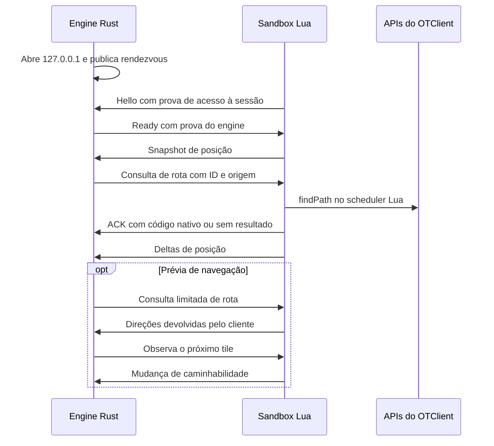

# Arquitetura Rust

A entrega atual é um diagnóstico de IPC e navegação em modo de observação. O `_Loader.lua` na raiz continua sendo a entrada do bot Lua ativo. O perfil experimental contém apenas `bridge/_Loader.lua` e a configuração de sessão escrita pelo executável.

Cada invocação abre uma sessão descartável. O segredo de cada lado é aleatório e possui escopo de uma execução. O listener já está vinculado quando publica o arquivo de rendezvous. O engine rejeita origens de navegador, limita frames a 4 KiB e verifica sequência, posição, ID da consulta e prazo. O arquivo é removido depois da autenticação e quando o processo sai normalmente. Em POSIX, o arquivo é criado com modo 0600. No Windows, use o diretório de perfil do próprio usuário com ACL herdada e restrita.

A ponte executa consultas nativas de rota e observações do próximo tile. O modo de prévia aceita destinos até 32 SQM no mesmo andar, com orçamento de 512 nós e rota de até 64 tiles. O Rust mantém o cursor e reusa o caminho até confirmar o passo observado, detectar desvio ou receber mudança de caminhabilidade. O callback de posição pode refletir prewalk e serve como observação local na prévia. A confirmação de execução automatizada dependerá de conciliação com o estado nativo e testes no servidor. O resultado da API Lua chega com o ID da consulta. Mudança na posição invalida a origem. A última observação de movimento de criatura em cada janela de 50 ms é enviada ao engine. Mudança de andar descarta observações do andar anterior.

A lógica Rust de navegação classifica bloqueio por criatura e terreno com duas leituras de caminhabilidade. A escolha de posição de tiro considera andar, distância, obstáculo, linha de visão e custo, com desempate leste–oeste e norte–sul pelas coordenadas. Follow calcula o excesso em relação a 1 SQM no mesmo andar. Essas regras têm testes no domínio e ainda aguardam integração ao executor de movimento.

O crate `nexbot-engine` agrupa protocolo, sessão e navegação. O atualizador genérico é um pacote separado. O engine roda sem depender de HTTP externo para suas decisões locais. O bootstrap usa o marcador `nexbot-ipc-health-v1` após o round trip da consulta nativa para qualificar um candidato. Latência do cliente, confirmação pelo servidor e política de cutover dependem de teste conectado.

## Limitações do IPC

O tempo de ida e volta inclui duas filas e processamento da sandbox. Suporte a WebSocket e leitura do rendezvous precisa ser confirmado por build. O teste local com um cliente sintético valida o fio WebSocket e o processo Rust. Os testes Lua exercitam a ponte com APIs simuladas.
